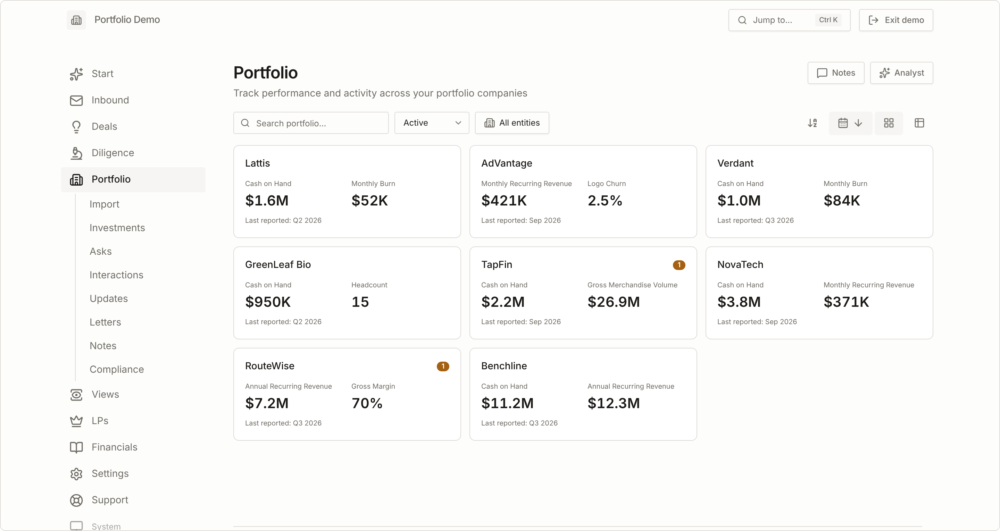
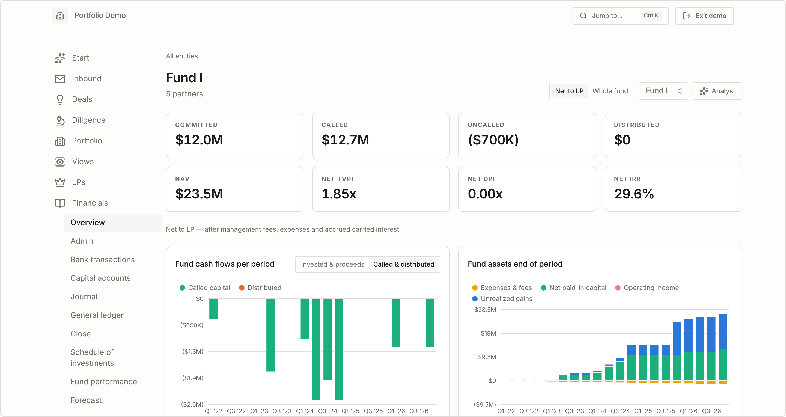
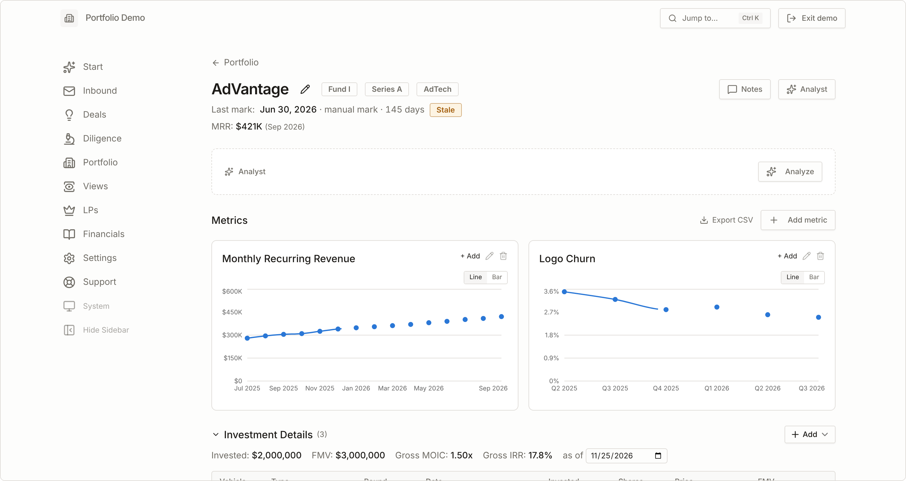
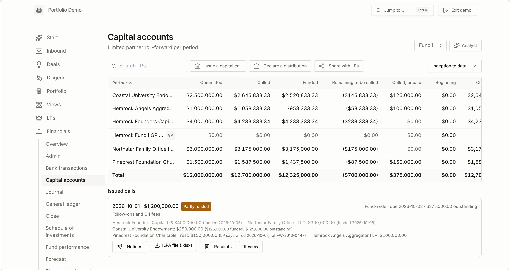
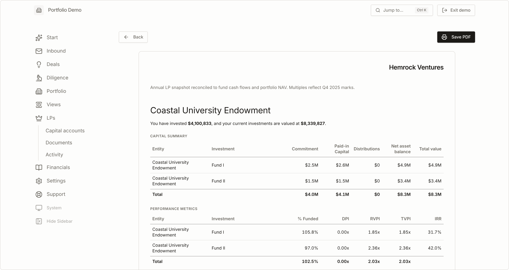
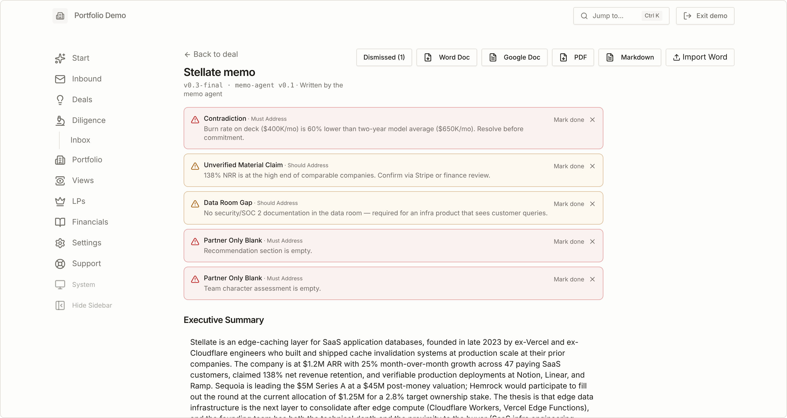
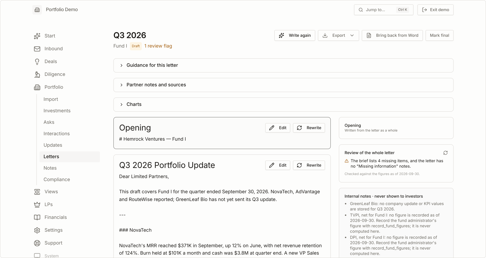
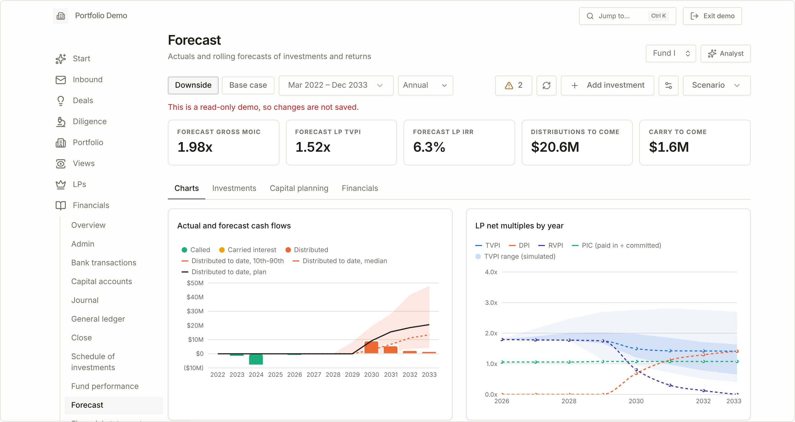
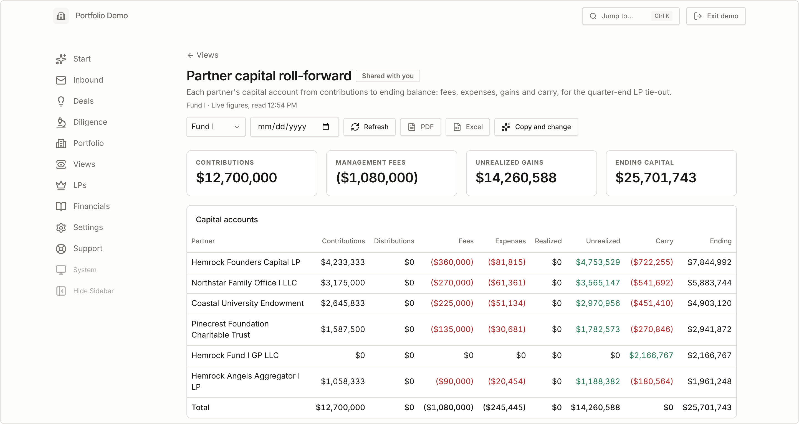

<p align="center">
  
</p>

<h1 align="center">Portfolio, by Hemrock</h1>

<p align="center">
  Open-source portfolio reporting, investment workflow, LP reporting and fund operations for venture funds.<br>
  Your books, your database, your AI.
</p>

<p align="center">
  <a href="https://www.hemrock.com/demo"></a>&nbsp;
  <a href="./DOCS.md"></a>&nbsp;
  <a href="./MCP.md"></a>&nbsp;
  <a href="./ROADMAP.md"></a>&nbsp;
  <a href="./CHANGELOG.md"></a>&nbsp;
  <a href="./LICENSE.md"></a>&nbsp;
  <a href="https://github.com/tdavidson/portfolio/stargazers"></a>
</p>

> [!TIP]
> **Don't want to run it yourself?** Taylor offers paid **setup and support**: Portfolio deployed on your own infrastructure and accounts, with onboarding and ongoing help. Your data still lives in your database. [Get in touch →](https://www.hemrock.com/contact)

Free, open source software for small venture funds: portfolio monitoring built from founder updates, LP letters and capital statements, deal flow and fund accounting. It runs on your own infrastructure with your own AI provider.

Portfolio is an open-source operating platform for small and emerging venture funds, from solo GPs and SPVs to micro funds. Take a company from inbound screening and diligence through investment, portfolio monitoring, fund accounting, and LP reporting—all in one system. Turn on only the workflows you need, deploy on your own infrastructure, and use your own AI providers. Product site and documentation: [hemrock.com/portfolio](https://www.hemrock.com/portfolio).



## What it does

Portfolio gives your team one source of truth from the first look at a deal through the life of the investment. Forward founder updates, import existing data, and let AI extract the metrics, investments, and cash flows that keep portfolio dashboards and reports current.

The investment workflow classifies and fit-scores inbound opportunities, runs your diligence checklist against the data room, verifies claims with sourced external research, and drafts investment memos in your firm's structure and voice.

Fund operations run on real double-entry books that keep themselves: every entity has its ledger from the day it is created, and recording an investment, a mark, an exit or a capital call posts it — so capital accounts, statements, carry and LP reporting flow from the books whether or not anyone opens the accounting pages. Turn on the views you need, when you need them. A secure LP portal delivers statements, letters, and fund documents and records engagement.

## Who it's for

Portfolio is built for small funds that carry the same reporting obligations as large ones without the headcount. It's free, with no per-seat fees, and your data stays in your own database. It works alongside your fund administrator, not in place of one.

- **[Solo GPs](https://www.hemrock.com/portfolio/solo-gps)** — the quarterly LP pack (statements, report cards, the letter) built from your own books instead of a week of spreadsheets.
- **[Micro VCs](https://www.hemrock.com/portfolio/micro-vc)** — capital calls, distributions and notices, partner capital accounts, management fees and carry, with a close you can re-run and verify.
- **[SPVs](https://www.hemrock.com/portfolio/spvs)** — one ledger per vehicle from day one, LP onboarding through a portal, and K-1 prep data at year end.
- **[Angels and syndicates](https://www.hemrock.com/portfolio/angels-syndicates)** — founder updates forwarded by email turned into tracked metrics, marks and TVPI without data entry.

## How it works

- **Portfolio Reporting** — Forward founder updates in any format or import existing spreadsheets. AI identifies each company, extracts metrics, investments, and cash flows, and sends uncertain results to a review queue. Track custom KPIs, valuations, proceeds, TVPI, DPI, and Net IRR in current dashboards.
- **Investment Workflow** — Classify and thesis-score inbound pitches, manage the deal pipeline, run your diligence checklist against uploaded data rooms, verify claims through sourced external research, and draft an investment memo in your firm's voice with paragraph-level provenance.
- **LP Reporting** — Track commitments, paid-in capital, distributions, and NAV across vehicles as dated positions; generate statements and quarterly letters; and deliver reports and documents through a secure, fund-branded LP portal with engagement tracking. Investors can also connect Claude or ChatGPT to their own portal.
- **Fund Operations** — Double-entry books for every entity, kept as you record investments and capital calls; import bank activity, run monthly closes, maintain partner capital accounts, model management fees and carried interest, budget and forecast each entity, and track compliance obligations.
- **Your AI, your data** — Connect Claude or ChatGPT to your own deployment over MCP with a plugin built for your address. Ask "what can you do?" for a home dashboard of what you can open and what to ask; open live portfolio, company, statement, LP capital and capital-call dashboards inside the conversation (who has paid, who says they wired, who still owes) and save them; pick ready-made prompts like *Quarter-end review* from the prompt menu; and get an LP's capital account statement or report card as a PDF link — every answer scoped to the access of the person signed in. No server AI key is required: without one, your own assistant does the AI work, from reading emailed updates and scanned pages to running the memo agent's stages, and the web app's AI buttons are the main thing you give up ([what works without a key](./DOCS.md#ai-without-a-server-key)).
- **Headless by design** — Chat and scripts are first-class ways in and out, not an add-on to the web app. Set up a fund, add the team, record investments, post entries and close periods from Claude, ChatGPT or your own agent (MCP and a REST API); read anything back the same way. The web app is a view of the same data, and the preformatted PDFs and reports stay. Every change, whichever way it comes in, passes the same access rules and is recorded in the audit trail with its source (web, API or MCP); a change from a connected assistant waits for a person to approve it. Data from other systems comes in through private connectors you keep in your own repository (a template for QuickBooks- and Carta-style ledgers is in `examples/connector-template`).
- **Custom views** — Describe a screen ("NAV, unfunded and the largest positions by vehicle") or pick a starter, and get it built on live portfolio, fund and LP data: KPI tiles, a dozen chart types, tables with totals and pivots, page filters, and PDF and Excel export. Each view loads with the viewer's own access, in the app or inside Claude and ChatGPT.
- **AI Analyst and CRM** — Ask questions grounded in your fund's actual data, compare companies, surface trends, share Notes with your team, and log conversations and introductions through your inbound address.
- **Access by entity and by area** — Grant each team member the funds, SPVs and entities they work on, and the areas (portfolio, accounting, LP capital, carry, tax…) they may read or edit, in one step with presets for a CFO, fund administrator, tax preparer, auditor, investment team or investor relations, and with an end date for anyone here for one engagement. Deletes, moving money, anything sent to LPs and finalizing K-1s need an admin. Enforced the same way in the app, over the API and over MCP, with entity scoping also enforced in the database.
- **Modular and self-hosted** — Enable only the workflows you use, add all of your funds, SPVs, and team members without per-seat fees, and install the fund-branded app on a phone.

> Detailed feature descriptions at [FEATURES](./FEATURES.md)  
> Fund accounting, forecasting and the double-entry reference at [ACCOUNTING](./ACCOUNTING.md)  
> Using Claude, ChatGPT and other agents with your fund at [MCP](./MCP.md), every tool at [MCP-TOOLS](./MCP-TOOLS.md)  
> Connecting Claude and ChatGPT at [DOCS](./DOCS.md#connecting-claude-chatgpt-and-other-agents)  
> What the app can do that MCP and the API can't yet, and why, at [PARITY](./PARITY.md)  
> Setting up a fund from chat or a script, with no web app at [DOCS](./DOCS.md#setting-up-a-fund-with-claude-chatgpt-or-a-script)  
> Bringing data in from QuickBooks, Carta and other systems with connectors at [DOCS](./DOCS.md#data-connectors)

## Screenshots

All screenshots show the demo's sample fund. [Try it yourself](https://www.hemrock.com/demo), no signup required.

| Fund overview | Company |
|---|---|
|  |  |
| **Capital accounts** | **LP report card** |
|  |  |
| **Investment memo** | **Quarterly letter** |
|  |  |
| **Forecast** | **Custom view** |
|  |  |

## How the numbers are calculated

Fund software is only as good as the trust you can put in its figures, so every number in Portfolio can be traced and re-derived.

1. **Real double-entry books.** Every entity has its own ledger. Recording an investment, a mark, a call or a distribution posts a balanced entry (debits positive, credits negative, every entry sums to zero). Statements, capital accounts, TVPI, DPI and IRR are computed from those postings, not typed in.
2. **Closes you can verify without the app.** Each period close keeps a reproducibility bundle: the ledger snapshot, the fund's terms, the statements and a manifest of SHA-256 hashes. The open fund engine in [`packages/fund-engine`](./packages/fund-engine) recomputes the statements from the ledger and checks they match exactly: `node packages/fund-engine/bin/fund-engine.mjs verify --bundle <dir>`.
3. **A hash-chained audit trail.** Every change records who made it and where it came from (web, API or MCP), chained so that an edit to history shows up as a break.
4. **People approve what assistants change.** A change proposed from Claude or ChatGPT waits for a person, and anything sent to LPs or moving money needs an admin.
5. **Your administrator's figures, side by side.** A vehicle can report the administrator's figures as stated, and the app reconciles its own books against them.

The full reference is in [ACCOUNTING](./ACCOUNTING.md), including [Verifying a close independently](./ACCOUNTING.md#verifying-a-close-independently).

## Use it from Claude, ChatGPT and coding agents

Every Portfolio install is an MCP server at `https://<your-domain>/api/mcp`. Sign in with OAuth from the client, or use an API key from **Settings → API and MCP** (a key can be read-only). An admin turns this on under **Settings → Agent access**.

```bash
# Every MCP client installed on this machine at once
npx add-mcp https://<your-domain>/api/mcp --name portfolio

# Claude Code (then run /mcp and choose Authenticate)
claude mcp add --transport http portfolio https://<your-domain>/api/mcp

# Codex
codex mcp add portfolio --url https://<your-domain>/api/mcp

# VS Code
code --add-mcp '{"name":"portfolio","type":"http","url":"https://<your-domain>/api/mcp"}'
```

In Claude.ai and ChatGPT, add a custom connector with the same URL, or install the plugin your deployment builds for its own address. Ask "what can you do?" to start. Details: [MCP](./MCP.md), every tool: [MCP-TOOLS](./MCP-TOOLS.md).

**Skills.** The repo ships agent skills for the jobs funds do every quarter: the LP letter, the investment memo, fund questions and dashboards. Install them into Claude Code, Cursor, Codex and other agents with one command:

```bash
npx skills add tdavidson/portfolio
```

Or pick one: `npx skills add tdavidson/portfolio --skill lp-quarterly-letter`. They live in [`plugin/skills`](./plugin/skills) and read your fund through the MCP connection.

## Why you should use this

- **Data consistency and availability** - One source of truth for your team. Reduce your reliance on a maze of spreadsheets. Everyone works from the same portfolio data, metrics, and reports from a central location.
- **Built to work with AI** - Bring your fund data to your own AI, and use it to ask anything about your portfolio and fund. Ask about benchmarks, trends, industry data, research, and more.
- **Professionalize internal operations** - Institutional-quality reporting infrastructure without the cost of enterprise software. Run it yourself, on your own terms.
- **Built for how funds work** - Designed by a fund CFO for key workflows, including investor updates, LP reporting, and portfolio monitoring. Works alongside your fund admin and operations team.

## Why this exists

I've spent over a decade as a fund CFO, investor, and consultant — working with thousands of GPs and founders on the exact problem this tool solves: manually collecting, analyzing, and presenting portfolio data every quarter.

Most portfolio reporting platforms lock your data in their database, process it through their AI, and charge per seat so half your team can't log in. Fund managers shouldn't have to choose between good tooling and owning their data.

This is a complete investment-firm operations platform you deploy on your own infrastructure — your database, your AI keys, your domain. It's open source under the Apache 2.0 license: free to use, modify, and run forever, for your own fund or commercially. No per-seat fees. No black-box AI training on your portfolio. No vendor lock-in.

Built by Taylor Davidson at [Hemrock](https://www.hemrock.com). Built by a fund manager, for fund managers.

## Get started

Free and open source under the Apache 2.0 license: use it, modify it, and deploy it on your own infrastructure and domain, for your own fund or commercially. [Try the demo](https://www.hemrock.com/demo) with sample data, no signup required.

Deploy in one click, then follow the quick start below for the database and sign-in:

[](https://vercel.com/new/clone?repository-url=https%3A%2F%2Fgithub.com%2Ftdavidson%2Fportfolio&env=NEXT_PUBLIC_SUPABASE_URL,NEXT_PUBLIC_SUPABASE_ANON_KEY,SUPABASE_SERVICE_ROLE_KEY,ENCRYPTION_KEY,NEXT_PUBLIC_APP_URL&envDescription=Required%20environment%20variables%20for%20Portfolio&project-name=portfolio)
[](https://app.netlify.com/start/deploy?repository=https://github.com/tdavidson/portfolio)

Prefer not to run it yourself? Taylor offers paid **setup and support**: deployed on your own infrastructure and accounts, with onboarding and ongoing support. [Contact Taylor](https://www.hemrock.com/contact).

## Quick start

- **Clone the repo** — `git clone https://github.com/tdavidson/portfolio.git && cd portfolio && npm install`
- **Create a Supabase project** — Copy your project URL, anon key, and service role key
- **Generate an encryption key** — openssl rand -hex 32
- **Deploy to Vercel or Netlify** — with the buttons above, or the steps in the full guide
- **Configure auth and add your first user** — Set Supabase redirect URLs and whitelist your email
- **Add an AI key, or skip it and use your own assistant, and forward your first email** — Anthropic, OpenAI or OpenRouter on the server, or Claude or ChatGPT over MCP with no key: [AI without a server key](./DOCS.md#ai-without-a-server-key)
- **Set up your fund** — entity, LPs, investments, then open the books, with CSV templates: [Setting up a new fund](./DOCS.md#setting-up-a-new-fund)

Or let a script do most of it: after cloning, `npm run setup` creates the database (with the Supabase CLI), deploys (with the Vercel CLI), configures sign-in and creates your fund, offering to install either CLI you don't have and printing the manual step for anything it can't do. It also asks how AI should work: with a server key, or with no key, where your own Claude or ChatGPT does the AI work over MCP. See [The quick way](./DOCS.md#the-quick-way-npm-run-setup).

Or set it up headless. After the database and deploy steps, `npm run bootstrap -- --email you@yourfund.com --fund "Your Fund"` creates your account, the fund and an API key without opening the web app, or add your email to `allowed_signups`, connect Claude or ChatGPT to `https://<your-domain>/api/mcp` and name your fund on the consent screen. Then run the **Set up this fund** prompt: [Setting up a fund with Claude, ChatGPT or a script](./DOCS.md#setting-up-a-fund-with-claude-chatgpt-or-a-script)

Full deployment guide with detailed steps, optional services, and local development setup: [DOCS](./DOCS.md)

For setup assistance or hosted deployments: [hemrock.com/contact](https://www.hemrock.com/contact). For bug reports and feature requests: [GitHub Issues](https://github.com/tdavidson/portfolio/issues).

## Roadmap and changelog

What shipped recently and what's next is in [ROADMAP](./ROADMAP.md); every release is in the [CHANGELOG](./CHANGELOG.md) and on [GitHub Releases](https://github.com/tdavidson/portfolio/releases).  

Ideas and requests are welcome in [Discussions](https://github.com/tdavidson/portfolio/discussions) or [Issues](https://github.com/tdavidson/portfolio/issues).

## Contributing

See [CONTRIBUTING](./CONTRIBUTING.md) and the issues labeled [good first issue](https://github.com/tdavidson/portfolio/issues?q=is%3Aissue+is%3Aopen+label%3A%22good+first+issue%22). Please follow the [Code of Conduct](./CODE_OF_CONDUCT.md).

## Sponsor Portfolio

Portfolio is free, and one person builds it. Sponsoring keeps it that way for every fund that runs it:

- **Fund-specific work stays current.** Tax forms, ILPA templates, filing calendars and accounting rules change every year; sponsorship pays for keeping up with them.
- **Security reviews and dependency updates** for software that holds LP and fund data.
- **More of the roadmap, sooner**, with sponsors' requests weighed first.

If Portfolio saves your fund an administrator's hours or a software bill, consider [sponsoring on GitHub](https://github.com/sponsors/tdavidson).

## Security

Please report vulnerabilities privately, as described in [SECURITY](./SECURITY.md), not in a public issue.

## License

Portfolio is open source under the [Apache 2.0 license](./LICENSE.md). If you use it in research or writing, [CITATION.cff](./CITATION.cff) has the citation.
